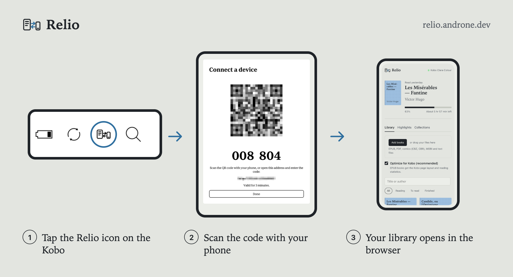
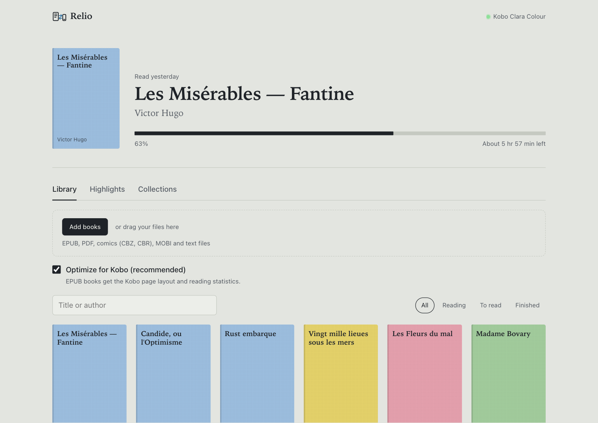
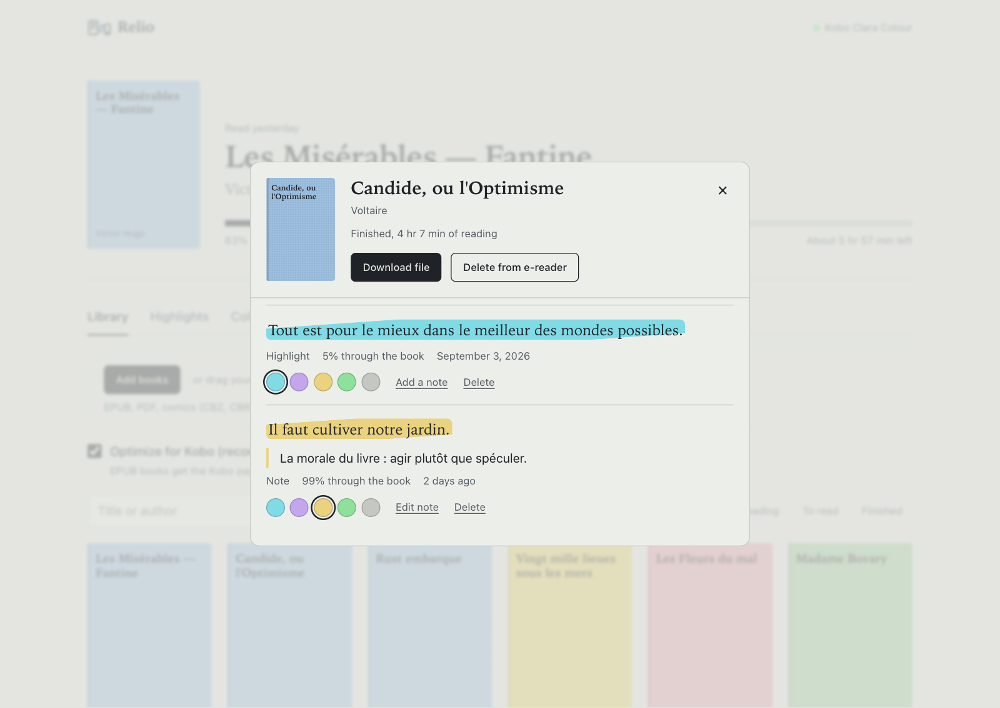
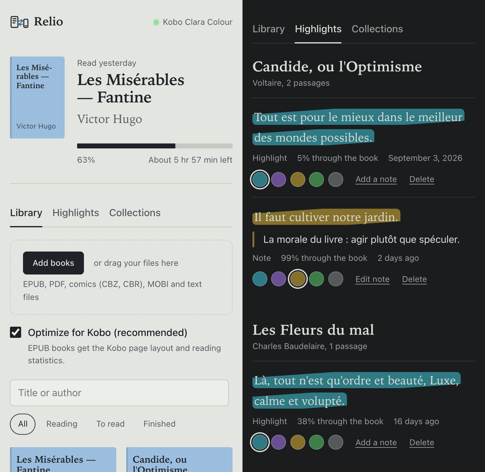
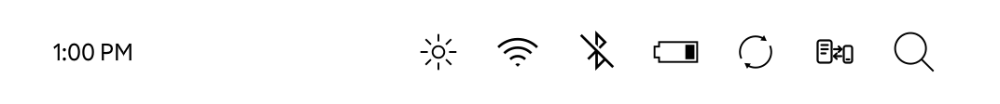
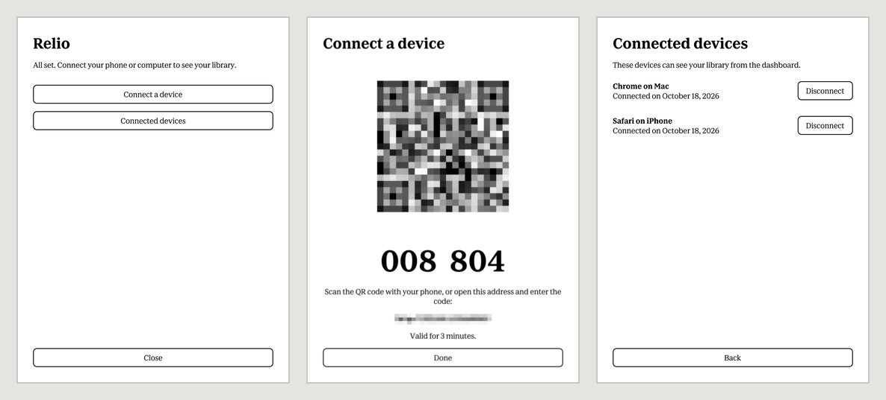

  

<h1 align="center">Relio</h1>

  Your Kobo library on your phone and computer. 
  Books, reading progress and highlights, straight from the e-reader over your Wi-Fi.

  
  
  
  
  
  

  

Relio adds a button to your Kobo's status bar. Tap it, scan the QR code with your phone, and your
library opens in the browser: what you're reading, your highlights and notes, your collections.
Add books by dragging them in, fix a highlight, delete a book, all without a cable, an account or a
cloud.

## Features

**On the e-reader**

- Its own icon next to search in the status bar, drawn to match Nickel's. No NickelMenu or other
  mod needed.
- A panel to connect a phone or computer with a QR code or a six-digit code, and to see and
  disconnect the devices that have access.
- Follows the e-reader's language.

**In the browser**

- The book you're reading, with its progress and the time left.
- The library with covers, search and filters by reading state.
- Drag and drop to add books. EPUBs are converted to KEPUB on the e-reader, so they get the Kobo
  page layout and reading statistics.
- Highlights and notes for every book: change the colour, add or edit a note, delete.
- Your collections, as set up on the Kobo.
- Download or delete a book, with a confirmation first.
- Made for phones too, follows the light or dark theme, and adds to the home screen.
- Available in 30 languages.

  

  

  

  

  

## Install

1. Plug the Kobo into a computer and tap Connect on its screen.
2. Download `KoboRoot.tgz` from the [latest release](../../releases/latest) and copy it into the
   hidden `.kobo` folder of the e-reader, without renaming it.
3. Eject the Kobo and unplug it. It installs the update while restarting, in about a minute.
4. Turn on Wi-Fi. The Relio icon shows up in the status bar.

With Chrome or Edge on a computer, the [installer page](https://relio.androne.dev/) does steps 2
and 3 for you.

To connect a phone, tap the Relio icon, then Connect a device, and scan the QR code. Both need to
be on the same Wi-Fi network.

## Updates

While Wi-Fi is on, the e-reader checks for a new version about once a day. Releases are signed,
and the e-reader refuses any package this project didn't sign. A new version downloads in the
background and installs the next time the e-reader restarts; the Relio panel says when one is
ready and can restart the e-reader for you. If a new version of the daemon fails to start, the
previous one comes back.

To turn the checks off, create an empty file `.adds/relio/no-updates` on the e-reader.

## Privacy

- The dashboard is served by the e-reader itself. Your library never leaves your network, and
  there's no account to create.
- The only request to the internet is the update check. It fetches a small file from
  relio.androne.dev or GitHub and sends nothing but the installed version.
- A browser only gets access after you enter the code shown on the Kobo. Codes last three minutes.
- Every connected device is listed on the e-reader, and you can disconnect it at any time.
- The dashboard loads nothing from third parties: no fonts, no CDN, no analytics.

## Compatibility

Relio is tested on a Kobo Clara Colour with firmware 4.46. The daemon is a static ARMv7 binary and
the plugin targets the Qt version Nickel ships with, so other recent models should work too, but
they haven't been tried yet. If you run it on another model, an issue saying how it went is very
welcome.

If Nickel ever crashes at startup, the plugin turns itself off at the next restart. To turn it off
by hand, create an empty file `.adds/relio/disable-plugin` on the e-reader and restart.

## How it works

| Part | Role |
| --- | --- |
| `nickel/` | Qt plugin loaded by Nickel: status bar icon and panel |
| `crates/reliod` | Daemon on the Kobo: dashboard, API, pairing, uploads |
| `crates/relio-core` | Reads and edits `KoboReader.sqlite` across firmware versions |
| `crates/relio-kepub` | EPUB to KEPUB conversion, a port of kepubify |
| `web/` | Dashboard and installer page |
| `i18n/` | Every user-facing text, one file per language |

The details are in [docs/architecture.md](docs/architecture.md) and
[docs/firmware-notes.md](docs/firmware-notes.md), and what's next in [docs/roadmap.md](docs/roadmap.md).

## Contributing

Building, running the daemon on your computer, working on a device and adding a language are
covered in [CONTRIBUTING.md](CONTRIBUTING.md).

## License

Relio is released under the [Apache License 2.0](LICENSE). The KEPUB converter is a port of
[kepubify](https://github.com/pgaskin/kepubify); its notices are in [NOTICE](NOTICE).

Relio is not affiliated with Rakuten Kobo Inc. Kobo is a trademark of Rakuten Kobo Inc.
